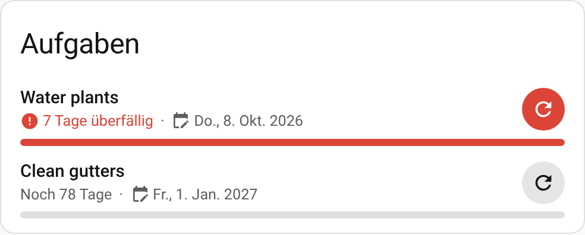

<p align="center"></p>

# Chore Reminder for Home Assistant

[](https://my.home-assistant.io/redirect/hacs_repository/?owner=niku85&repository=homeassistant-repo&category=integration)

[](https://hacs.xyz/docs/faq/custom_repositories)
[](https://github.com/niku85/homeassistant-repo/actions/workflows/validate.yml)

Never forget to water the plants, change the bed sheets or descale the coffee
machine again. **Chore Reminder** is a Home Assistant integration plus a
dashboard card that counts down to the next time a recurring chore is due.



## Features

- Create any number of chores from the UI – each with a **name**, a **start date**
  (calendar picker) and a **repeat interval** in days, weeks or months.
- A Lovelace card that shows, for every chore:
  - the chore name,
  - **days until** it is due (`5 days left`, `Due today`, …),
  - the **target date**,
  - a **progress bar** that fills up towards the target date –
    **green** while the target date has not been reached,
    **red** once it is in the past and the chore has not been done,
  - a red **(!)** icon with **“x days overdue”** when the chore is late,
  - a **refresh button** to mark the chore done, which restarts the countdown from today.
    It needs a second tap to confirm, so an accidental tap does nothing.
  - tap the **target date** to change it, e.g. to undo an accidental *mark done*.
- The card ships with the integration – no extra resource to install.
- Entities for automations and notifications:

  | Entity | Description |
  | --- | --- |
  | `sensor.<chore>` | Days until due (negative when overdue). Attributes: `next_due`, `last_done`, `start_date`, `interval`, `interval_unit`, `progress`, `overdue`, `days_overdue`, … |
  | `binary_sensor.<chore>_overdue` | `on` when the target date has passed |
  | `button.<chore>_mark_done` | Marks the chore as done today |
  | `date.<chore>_next_due_date` | The next due date – change it to move the target date by hand |

- Service `chore_reminder.mark_done` (target: a chore sensor).
- English and German (follows your Home Assistant language).
- Its own icon (light and dark variants) on the integrations page, shipped in
  `custom_components/chore_reminder/brand/` (shown from Home Assistant 2026.3).

## Installation

### HACS (recommended)

1. Click the **Open in HACS** button above, or in HACS open
   *⋮ → Custom repositories*, add `https://github.com/niku85/homeassistant-repo`
   with type **Integration**.
2. Install **Chore Reminder** and restart Home Assistant.

### Manual

Copy `custom_components/chore_reminder` into the `custom_components` folder of
your Home Assistant configuration and restart Home Assistant.

## Setup

[](https://my.home-assistant.io/redirect/config_flow_start/?domain=chore_reminder)

*Settings → Devices & services → Add integration → Chore Reminder*, then enter:

| Field | Meaning |
| --- | --- |
| Chore name | e.g. `Water plants` |
| Start date | The day the countdown starts (calendar picker) |
| Repeat every / Unit | e.g. `3` `Days`, `2` `Weeks`, `1` `Months` |

Add the integration once per chore. The first target date is
*start date + interval*. Pressing the refresh button (or the *Mark done*
button entity) sets the last-done date to today, so the next target date is
*today + interval*. Start date and interval can be changed later via
**Configure** on the chore; changing the start date restarts the countdown
from the new date; changing the interval recalculates the next due date from
the last completion.

### Changing the next due date

Tap the date on the card (or open the chore's **Next due date** entity) and
pick a new date. This only moves the target date; the next *mark done* uses
the interval again. Use it to undo an accidental *mark done* or to shift a
chore by a few days.

## Dashboard card

After a restart the card appears in the card picker as **Chore Reminder** and
can be configured in the visual editor. YAML:

```yaml
type: custom:chore-reminder-card
title: Chores            # optional
entities:
  - sensor.water_plants
  - sensor.change_bed_sheets
```

`entity: sensor.water_plants` works as well for a single chore.
Set `confirm: false` to mark chores done with a single tap.
Set `sort: next_due` to order the chores by next due date, most overdue
first (default: as listed).

Colors follow your theme (`--success-color` / `--error-color`) and can be
overridden with `card-mod` via `--chore-ok-color` and `--chore-overdue-color`.

## Automation example

```yaml
automation:
  - alias: Notify about overdue chores
    triggers:
      - trigger: state
        entity_id: binary_sensor.water_plants_overdue
        to: "on"
    actions:
      - action: notify.notify
        data:
          message: "🌱 The plants need water!"
```

## Development

```bash
pip install -r requirements_test.txt
pytest
```

## Publishing a new version

1. Bump `version` in `custom_components/chore_reminder/manifest.json`
   (and `CARD_VERSION` in the card).
2. Create a GitHub release with a matching tag, e.g. `v1.0.1`. HACS offers
   releases as updates.

## License

MIT
